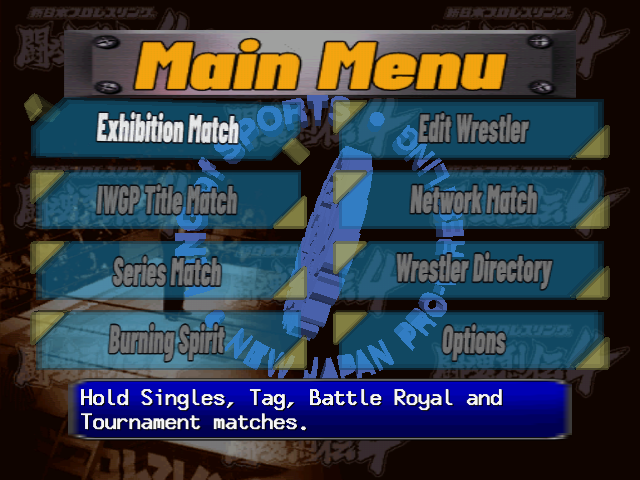
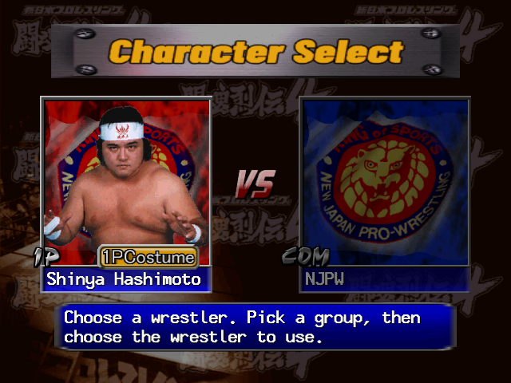
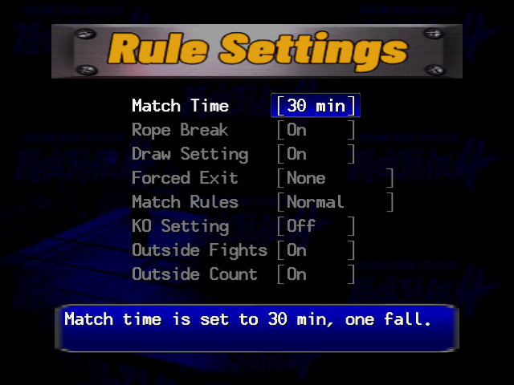
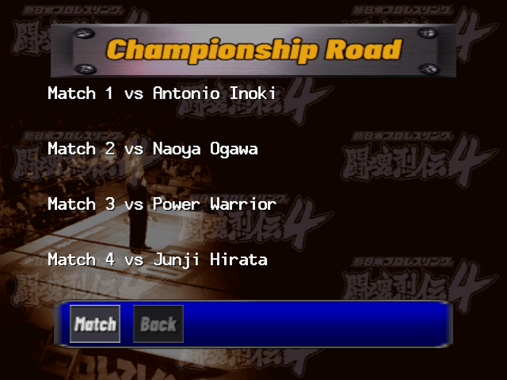
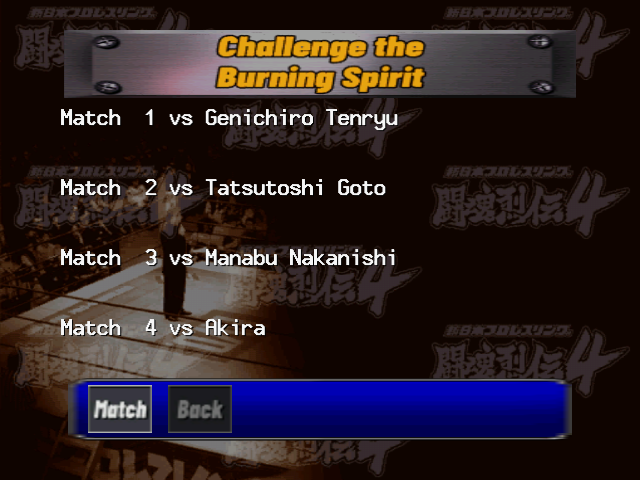
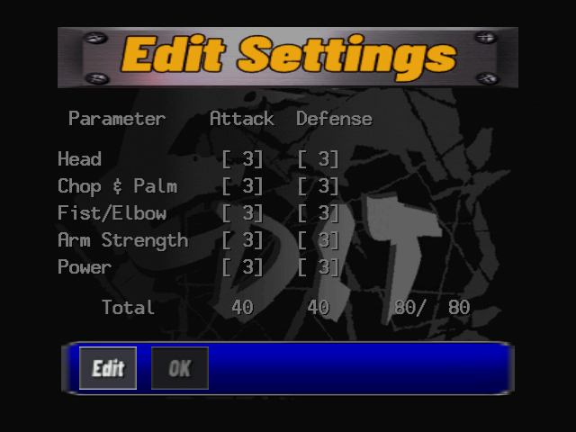
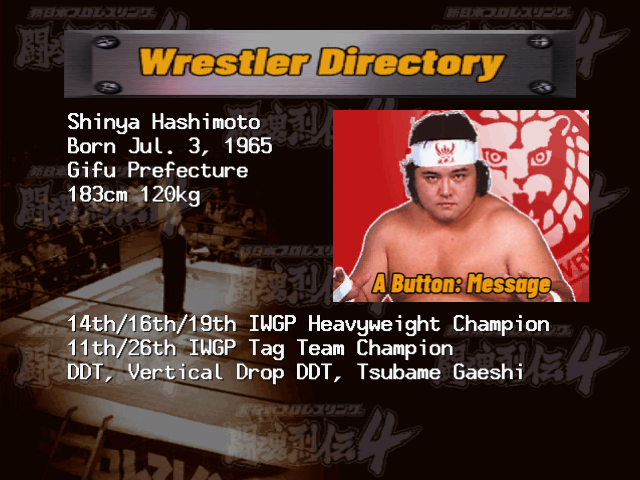
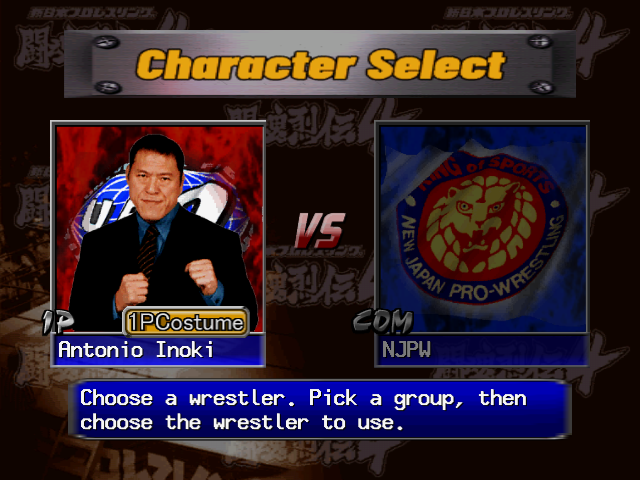

# Screenshots

Shin Nihon Pro Wrestling - Toukon Retsuden 4 with the English patch, at the Dreamcast's native
640x480, taken in Flycast.

## Main menu

Every mode on one screen. The menu labels are redrawn pictures, and the help line changes with the cursor.

## Character select

The roster under the wrestlers' real names: pick a group, then a wrestler. The heading and the costume tag are redrawn in English.

## Rule settings

Every rule and its value in English, with a description of the setting under the list.

## IWGP Title Match

The road to the IWGP belts: the opponents in line, with English buttons and headings.

## Challenge the Burning Spirit

The gauntlet mode whose clears unlock the hidden wrestlers.

## Edit Wrestler

Edit Wrestler's parameter screen, laid out again so the English columns sit under their headings.

## Wrestler Directory

Every wrestler's profile, translated.

## Hidden wrestlers (All Unlocked)

Antonio Inoki, one of the seven hidden wrestlers the (All Unlocked) patches open from the start.
